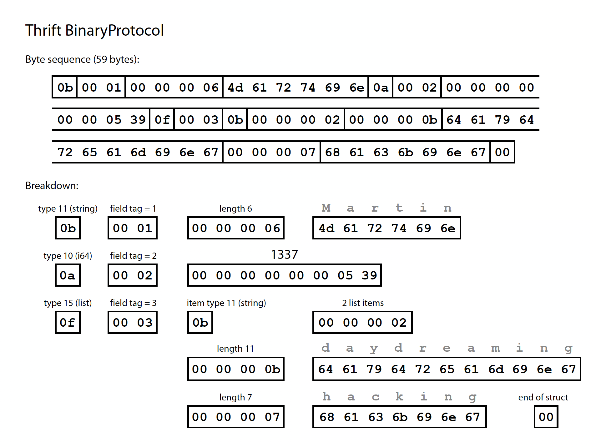
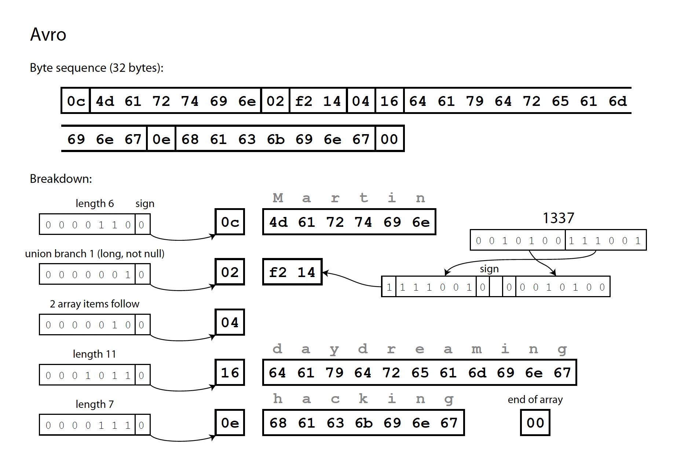

# Chapter 4: Encoding and Evolution

- Applications change over time, so they must be evolvable
- On the server side, **staged (rolling) rollouts** are common, allowing deployment without downtime
- This means old and new versions of the code, and old and new data formats, can coexist in the system at the same time
- **Backward compatibility**: newer code can read data that was written by older code
- **Forward compatibility**: older code can read data that was written by newer code
- In practice, backward compatibility is easier to achieve than forward compatibility

## Formats for Encoding Data

- Data is usually represented in two ways:
  - **In memory**: objects, structs, lists, hash tables etc., optimised for efficient access and manipulation by the CPU
  - **When writing to a file or sending over the network**: it must be encoded as a self-contained sequence of bytes, e.g. JSON
- Translating from the in-memory representation to bytes is **encoding** (serialization, marshalling); the reverse is **decoding** (parsing, deserialization, unmarshalling)

### Language-Specific Formats

- Many programming languages have built-in support for encoding in-memory objects (e.g. Java's `java.io.Serializable`, Python's `pickle`)
- Convenient, but they have a number of problems:
  - The encoding is tied to one language, so reading the data from another language is difficult. This can lock you into your current language for a long time
  - The decoder needs to be able to instantiate arbitrary classes, which is a source of security problems
  - Versioning is often an afterthought, so forward and backward compatibility are neglected
  - Efficiency is often an afterthought too, e.g. Java's built-in serialization is notoriously slow and bloated
- Generally, it's a bad idea to use your language's built-in encoding for anything other than very transient purposes

### JSON, XML and Binary Variants

- JSON, XML and CSV are popular, textual, and can be read and written by many programming languages
- They have subtle problems (e.g. ambiguity around numbers, no support for binary strings, verbosity), but their wide acceptance makes them good enough for many purposes, especially for data exchange between organisations

#### Binary encoding

- For data used only within an organisation, there is less pressure to use a lowest-common-denominator format
- Binary encodings of JSON and XML (e.g. MessagePack) are somewhat smaller than their textual counterparts, but since they still include all the field names, the savings are modest

### Thrift and Protocol Buffers

- Apache Thrift and Protocol Buffers (protobuf) are binary encoding libraries that both require a **schema** for any data that is encoded
- Both come with a code generation tool that takes a schema definition and produces classes implementing the schema in various programming languages
- Instead of field names, the encoded data contains **field tags** (numbers like 1, 2, 3 from the schema), which is what makes it compact
- Thrift has two binary encoding formats: **BinaryProtocol** and **CompactProtocol**
  - CompactProtocol packs the field type and tag number into a single byte, and uses variable-length integers
  - Protocol Buffers has a single binary format, very similar to CompactProtocol

*Thrift BinaryProtocol: each field is encoded as a type, a field tag and the value. 59 bytes in total.*

#### Field tags and schema evolution

- Schemas inevitably change over time. This is called **schema evolution**
- How do Thrift and Protocol Buffers handle schema changes while keeping forward and backward compatibility?
- **Field tags are critical**: a field's name can change, but its tag number cannot, because existing encoded data would become invalid
- **Adding fields**: give each new field a new tag number
  - Forward compatibility: old code that sees an unrecognised tag simply skips it (the type annotation tells it how many bytes to skip)
  - Backward compatibility: new code can still read old data, as long as each tag keeps its meaning. But a new field can't be `required`, since old data won't contain it, so new fields must be optional or have a default value
- **Removing fields**: like adding, but in reverse. You can only remove optional fields, never required ones, and you must never reuse a removed field's tag number
- **Changing a field's data type** is possible but risky, e.g. changing a 32-bit integer to 64-bit means old code reading new data may truncate the value or lose precision

### Avro

- Apache Avro is another binary encoding format, different from Thrift and Protocol Buffers
- It has two schema languages: **Avro IDL** (intended for human editing) and a JSON-based one (more easily machine-readable)
- Notably, there are **no tag numbers** in the schema, and nothing in the encoded data identifies fields or their data types: the values are just concatenated
- To parse the binary data, you go through the fields in the order they appear in the schema, and use the schema to tell you each field's data type
- This means the binary data can only be decoded correctly if the code reading the data uses the exact same schema as the code that wrote it, or a compatible one (see below)

*Avro: the same record in just 32 bytes. No field tags or types, only lengths and values. Integers use a variable-length zig-zag encoding.*

#### The writer's schema and the reader's schema

- When an application encodes data, it uses whatever version of the schema it knows about. This is the **writer's schema**
- When an application decodes data, it expects the data to be in some schema. This is the **reader's schema**
- The writer's and reader's schemas don't have to be the same, they only need to be **compatible**
- The Avro library resolves the differences by looking at both schemas side by side and translating the data from the writer's schema into the reader's schema
  - e.g. it's no problem if the fields are in a different order, because fields are matched up by name
  - A field in the writer's schema but not the reader's is ignored; a field in the reader's schema but not the writer's is filled in with its default value

#### Schema evolution rules

- To maintain compatibility, you may only add or remove a field that has a **default value**, e.g. `null`
- Adding a field without a default breaks backward compatibility; removing a field without a default breaks forward compatibility
- To allow a field to be null, you have to use a **union type**, e.g. `union { null, long }`
- Because of this, Avro doesn't have `optional` and `required` markers the way Thrift and Protocol Buffers do; it uses union types and default values instead

#### But what is the writer's schema?

- How does the reader know which writer's schema a particular piece of data was encoded with? It depends on the context:
  - **Large file with lots of records** (e.g. Hadoop): include the writer's schema once at the start of the file
  - **Database with individually written records**: include a version number at the start of each record, and keep a list of schema versions in the database. The reader fetches the schema for that version
  - **Sending records over a network connection**: the two processes can negotiate the schema version when the connection is set up, then use that schema for the lifetime of the connection

#### Dynamically generated schemas

- One advantage of Avro not using tag numbers is that it's well suited to **dynamically generated schemas**
- e.g. dumping a relational database to a file: an Avro schema can be generated from the relational schema, with each table becoming a record and each column a field
- If the database schema changes, you just generate a new Avro schema; fields are identified by name, so the reader can still match them up
- With Thrift or Protocol Buffers, field tags would have to be assigned by hand every time the database schema changes, keeping track of which column maps to which tag

#### Code generation and dynamically typed languages

- Thrift and Protocol Buffers rely on code generation. That suits statically typed languages (Java, C++, C#), since it allows efficient in-memory structures for decoded data and type checking at compile time
- In dynamically typed languages (JavaScript, Ruby, Python) there's little point, since there's no compile-time type checker to satisfy
- In Avro, code generation is optional for statically typed languages, and you can work without it
- An Avro object container file (which embeds the writer's schema) is **self-describing**, so it can be opened with the Avro library and read like a JSON file

### The Merits of Schemas

- Protocol Buffers, Thrift and Avro all use a schema to describe a binary encoding format. Their schema languages are much simpler than XML Schema or JSON Schema
- Textual formats like JSON are widespread, but binary encodings based on schemas are a viable option with several nice properties:
  - They are much more compact than textual encodings, since they can omit field names from the encoded data
  - The schema is a valuable form of documentation, and because it's required for decoding, you can be sure it's up to date
  - Keeping a database of schemas lets you check forward and backward compatibility of schema changes before anything is deployed
  - For statically typed languages, code generation from the schema enables type checking at compile time
- In summary, schema evolution gives the same kind of flexibility as schemaless / schema-on-read JSON databases, while also providing better guarantees about your data and better tooling
